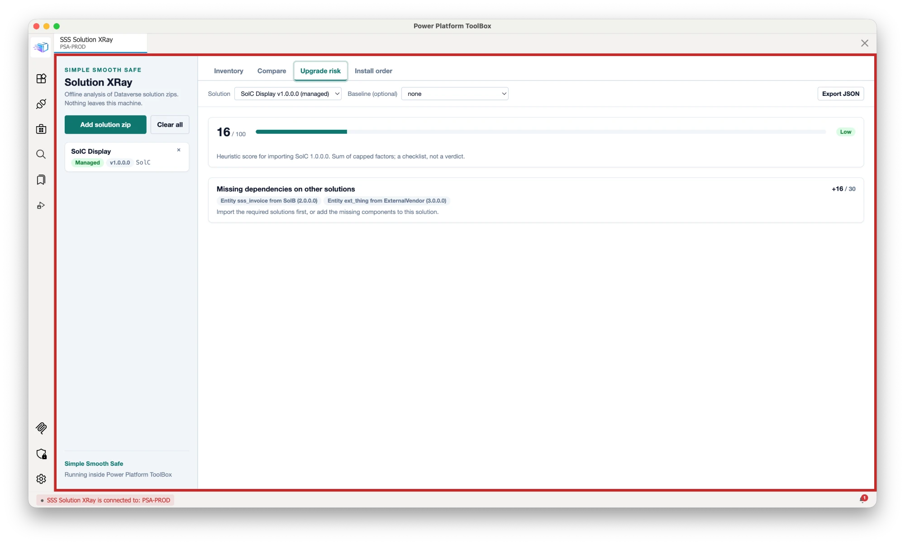

# Solution XRay

Offline analysis of Dataverse solution zips inside [Power Platform ToolBox](https://www.powerplatformtoolbox.com). No connection required. The zip never leaves your machine. The optional connection is used only by the *Post-import* tab, to read recent import job logs.

## What it does

Load one or more exported solution zips (managed or unmanaged) and get:

- **Inventory** — solution header (unique name, version, managed flag, publisher), root components by type, tables with column/form/view counts, relationships, global choices, processes and cloud flows (with the connection references each flow uses), model-driven and canvas apps, web resources, security roles, column security profiles, connection references, environment variables (default/value present?), plugin assemblies and steps, PCF controls, and the export's own declared missing dependencies.
- **Compare** — diff two zips (two versions of the same solution, or two different ones): added / removed / changed components per category, down to individual columns. Flags upgrade vs downgrade vs same version.
- **Upgrade risk** — a 0–100 heuristic score built from capped factors with evidence and advice for each: missing dependencies (a dependency on solution `Active` is scored as a blocker: the component exists only as unmanaged customization in the source environment and must be added to the solution or a prerequisite solution), unmanaged import, system (non-prefixed) tables included with all subcomponents, plugins, cloud flows whose connection references are not shipped, environment variables without values, canvas apps, size, publisher-prefix hygiene. Pick a baseline zip (the previous version) to also score removed tables, removed columns, version regressions (a lower version is blocked for managed imports; the same version is allowed but flagged lightly) and managed/unmanaged flips.
- **Post-import** — read a solution import's job log (the `importjob.data` XML, `<importexportxml>`) instead of reading it by hand: open the file or paste the XML, or, with a connection, pick one of the environment's 20 most recent import jobs. One table of components (name, type, result, error code, error text), failures and warnings first and shown alone by default (*Show: All results* lists the successes too), a filter box, counts per component type, the top error codes with an example message, and the solution-level result. When a loaded zip defines the same schema name (tables, processes by id, connection references, environment variables, web resources, roles, choices, apps, plugin assemblies and steps, PCF controls), the row gets an *Inventory* button that opens that zip's Inventory searching for it. Exports JSON and CSV (both honour the filter).
- **Install order** — load every solution you plan to import; the tool builds the dependency graph from `MissingDependencies` and shared tables (a table belongs to the solution that creates it; system tables such as `account` never create edges), runs a topological sort (Kahn) and reports the order, the reason for each edge, dependencies on solutions you did not load (including `Active`, i.e. unmanaged components missing from the export), and any dependency cycle with a concrete path.

Every tab exports its result as JSON (Post-import also as CSV). The Compare export is named `<A>-<version>_vs_<B>-<version>.diff.json` and honours the *Hide root-component rows* filter (recorded in its `filter` field).

## What this tool changes

**Nothing in any environment.** The tool reads exported solution zips and import job logs from disk. The only request it can send to Dataverse is one read, and only when a connection is selected and you click *Load recent import jobs* on the Post-import tab: `queryData("importjobs?$select=importjobid,solutionname,progress,completedon,data&$orderby=createdon desc&$top=20")`. It makes no create, update, delete, import, publish, layer, schema, ownership or security change anywhere, and calls no Power Platform API. It does not modify the zip or log files you load either; they are read into memory and discarded when you remove them, load another, click *Clear all* or close the tool.

The only things it writes:

- **Files you save** — *Export JSON* on each tab (`<solution>-<version>.xray.json`, `<A>-<version>_vs_<B>-<version>.diff.json`, `<solution>-<version>.risk.json`, `install-order.json`, `<solution>-<version>.importjob.json`), *Export CSV* on Post-import (`<solution>-<version>.importjob.csv`) and *Save log* in the debug footer (`solution-xray-debug-<timestamp>.txt`; its header lists the ToolBox connections by name and URL, read from ToolBox, not from Dataverse). Each is written only where you choose in the ToolBox save dialog (in a plain browser, the standard download).
- **Browser localStorage (per viewer, this tool only)** — view settings (Compare filters and search, *Hide root-component rows*, Inventory search, *Hide system tables*) under `sss-view:solution-xray`, and the *Debug log* switch under `sss-debug:solution-xray`. The theme follows ToolBox and is not stored.

Nothing else: no network calls other than the import job read above, no telemetry, no other files, no settings outside this tool.

## Screenshots

Captured inside Power Platform ToolBox with the sample zips.




## Install

**From the ToolBox marketplace** — search for "Solution XRay" once listed.

**From npm (ToolBox Debug menu)** — Settings → enable *Show Debug Menu* → Debug → *Install from npm* → `@simplesmoothsafe/pptb-solution-xray`.

**From source**

```bash
cd tools/solution-xray
npm install
npm run build
```

Then in ToolBox: Debug → *Load Local Tool* → select the `tools/solution-xray` folder (the one with `package.json`; files are served from `dist/`).

The built `dist/index.html` also runs in a plain browser (file picker and downloads fall back to standard browser APIs), which is how the smoke test drives it.

## Usage

1. **Add solution zip** — native file dialog inside ToolBox (one file per pick; repeat to add more). In a browser, multi-select and drag-and-drop also work.
2. Pick a tab. *Inventory* and *Upgrade risk* work with one zip; *Compare* and *Install order* need two or more. *Post-import* needs no zip: open or paste an import job log, or *Load recent import jobs* when a connection is selected (a zip is only used to link failed components to their definition).
3. *Export JSON* (and *Export CSV* on Post-import) saves the current analysis.

Notes:

- The tool reads `solution.xml`, `customizations.xml`, `Workflows/*.json` and `environmentvariabledefinitions/*/` (definition XML and `environmentvariablevalues.json`). Anything else in the zip is only counted.
- If the same unique name is loaded twice (two versions), *Install order* uses the highest version (the first loaded on a tie); remove the other to change that.
- Component type codes of 10000 and above are environment-specific (connection references, custom APIs, ...). They show as *Custom component (type N)* unless the zip reveals the table (a matching `connectionreferences` entry or a `customapis/` folder).
- The risk score is a checklist, not a verdict. Read the evidence.

## Limitations

- **Post-import, live source: not yet verified against a live environment.** The import job query and the log parser are covered by the e2e test with a synthetic log and a mocked host only. Real logs vary by component type; an element the tool does not recognise still appears under its XML element name as its type.
- Post-import reads the import job's data XML (`<importexportxml>`). The formatted log downloaded from the maker portal (an Excel XML workbook) is rejected with a message; open the job's data XML instead.
- Post-import links a component to a loaded zip only by schema name or process id; display names are not matched, and a component the zip does not itemise (e.g. site map nodes, forms) has no link.

## Debug log

For troubleshooting, tick **Debug log** in the footer, reproduce the problem, then **Save log**: a `solution-xray-debug-<timestamp>.txt` file with every ToolBox, Dataverse and Power Platform API call the tool made (the exact query or request, the response or error, timing), notifications, connection events and uncaught errors. The switch is remembered for this tool; `?debug=1` also turns it on. Off, nothing is recorded.

The file is written only where you save it. Secrets (keys named like password, secret, token, authorization) are redacted, and long strings, arrays and binary payloads are truncated, but responses still contain record data such as names and ids: review the file before you share it.

## Privacy

All processing happens in the tool's page. There is no network access of its own: no telemetry, no CDN, no fonts, and no CSP exceptions are requested; the only API call is the optional import job read through the ToolBox connection (see *What this tool changes*). The zip is read from disk through the ToolBox file API (or the browser file picker) and stays in memory for the session.

## Development

```bash
npm run build       # typecheck + Vite IIFE bundle + dist checks (no eval, no remote URLs, single script)
npm run dev-watch   # rebuild on change; reload the tool tab in ToolBox
npm run validate    # @pptb/validate manifest rules (does live HEAD checks on the README/repo URLs)
npm run e2e         # Playwright smoke test against dist/ (needs playwright + Chromium available)
```

Stack: TypeScript, Vite, [JSZip](https://stuk.github.io/jszip/). Types from `@pptb/types`. No framework.

## AI Assistance

Substantial parts of this tool's code and documentation were generated with Claude Code (Anthropic) and reviewed and maintained by the contributors listed in `package.json`. Real-environment testing status is stated in this README where a feature has not yet been verified.

## Credits

Built and maintained by Duarte Clemente ([Simple Smooth Safe](https://simplesmoothsafe.com)).

## License

MIT. See [LICENSE](https://github.com/sss-dclemente/sss-pptb/blob/main/tools/solution-xray/LICENSE).
