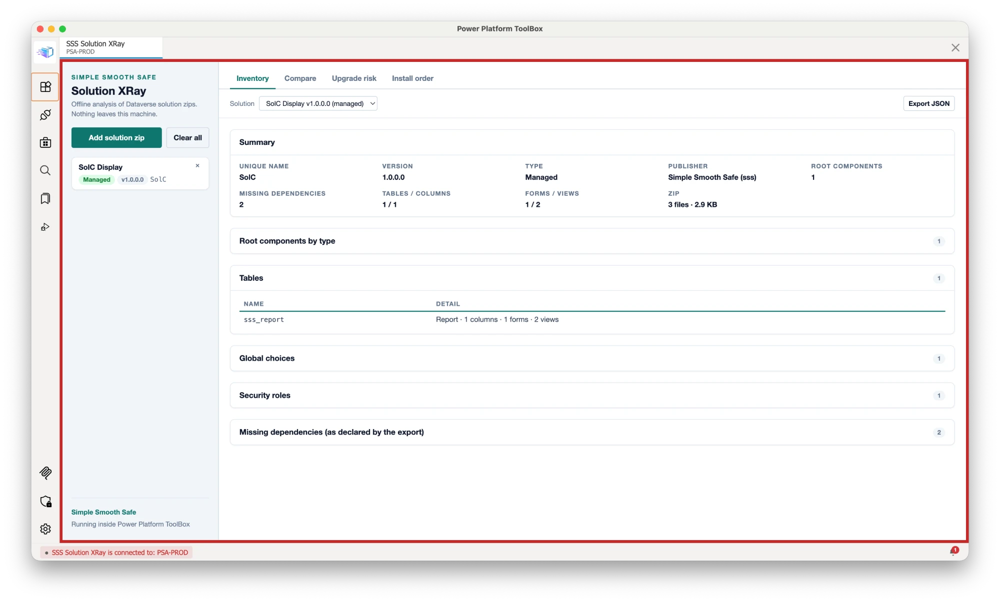

# Solution XRay

Offline analysis of Dataverse solution zips inside [Power Platform ToolBox](https://www.powerplatformtoolbox.com). No connection required for offline use: every tab works on zips from disk. The zip never leaves your machine. With a ToolBox connection, *live mode* also exports a solution from that environment (read-only) and checks your zip against it before you import, and the *Post-import* tab can read the environment's recent import job logs.

**How it differs from Solution Explorer and Solution Dependency Analyzer** (also in the ToolBox catalog): both work against solutions in a connected environment. Solution XRay needs no connection: it reads exported solution zips offline, so you can inspect, compare, risk-score and order solutions before they reach any environment.

## What it does

Load one or more exported solution zips (managed or unmanaged) and get:

- **Inventory** — solution header (unique name, version, managed flag, publisher), root components by type, tables with column/form/view counts, relationships, global choices, processes and cloud flows (with the triggers, connectors and connection references each flow uses), model-driven and canvas apps, web resources, security roles, column security profiles, connection references, environment variables (default/value present?), plugin assemblies and steps, PCF controls, and the export's own declared missing dependencies.
- **Compare** — diff two zips (two versions of the same solution, or two different ones): added / removed / changed components per category, down to individual columns. Flags upgrade vs downgrade vs same version.
- **Upgrade risk** — a 0–100 heuristic score built from capped factors with evidence and advice for each: missing dependencies (a dependency on solution `Active` is scored as a blocker: the component exists only as unmanaged customization in the source environment and must be added to the solution or a prerequisite solution), unmanaged import, system (non-prefixed) tables included with all subcomponents, plugins, cloud flows whose connection references are not shipped, environment variables without values, canvas apps, size, publisher-prefix hygiene. Pick a baseline zip (the previous version) to also score removed tables, removed columns, version regressions (a lower version is blocked for managed imports; the same version is allowed but flagged lightly) and managed/unmanaged flips.
- **Post-import** — read a solution import's job log (the `importjob.data` XML, `<importexportxml>`) instead of reading it by hand: open the file or paste the XML, or, with a connection, pick one of the environment's 20 most recent import jobs. One table of components (name, type, result, error code, error text), failures and warnings first and shown alone by default (*Show: All results* lists the successes too), a filter box, counts per component type, the top error codes with an example message, and the solution-level result. When a loaded zip defines the same schema name (tables, processes by id, connection references, environment variables, web resources, roles, choices, apps, plugin assemblies and steps, PCF controls), the row gets an *Inventory* button that opens that zip's Inventory searching for it. Exports JSON and CSV (both honour the filter).
- **Install order** — load every solution you plan to import; the tool builds the dependency graph from `MissingDependencies` and shared tables (a table belongs to the solution that creates it; system tables such as `account` never create edges), runs a topological sort (Kahn) and reports the order, the reason for each edge, dependencies on solutions you did not load (including `Active`, i.e. unmanaged components missing from the export), and any dependency cycle with a concrete path.

- **Check zip against environment (live mode, needs a connection)** — the sidebar's *Environment* panel lists the connected environment's solutions (`System`, `Active`, `Default`, `Basic`, hidden and `msdyn*` solutions are left out; managed solutions are listed but cannot be picked, because Dataverse does not export them). *Check zip against environment* exports the picked solution with `ExportSolution`, loads it into the sidebar like any zip, tagged `env: <connection name>`, and points *Compare* (A = environment, B = your zip) and *Upgrade risk* (your zip, baseline = environment) at the pair; the panel shows a summary (version direction, added / changed / removed, risk score) with links to both tabs. *Load only* exports without comparing. Every tab works on the exported solution unchanged. Without a connection the panel is disabled with a hint and nothing changes for offline use.

Every tab exports its result as JSON (Post-import also as CSV). The Compare export is named `<A>-<version>_vs_<B>-<version>.diff.json` and honours the *Hide root-component rows* filter (recorded in its `filter` field).

## What this tool changes

**Nothing in any environment.** It makes no create, update, delete, import, publish, layer, schema, ownership or security change anywhere. It does not modify the zip or import log files you load either; they are read into memory and discarded when you remove them, load another, click *Clear all* or close the tool.

- **Offline (no connection, or live mode and Post-import's live source unused)** — the tool reads exported solution zips and import job logs from disk and sends no request to Dataverse or Power Platform.
- **Live mode (with a connection)** — two read-only requests through ToolBox's Dataverse API, to the connected (primary) environment only: `getSolutions` (the solution list, when the connection is opened or *↻* is clicked) and the `ExportSolution` action (only when you click *Check zip against environment* or *Load only*). `ExportSolution` packages the solution and returns it; it changes nothing in the environment, though the export runs on the server and may be recorded in the environment's own logs like any export. The exported zip is kept in memory only, like a zip from disk; it is not written to disk unless you export a tab's JSON.
- **Post-import live source (with a connection)** — one read-only query, only when you click *Load recent import jobs*: `queryData("importjobs?$select=importjobid,solutionname,progress,completedon,data&$orderby=createdon desc&$top=20")`. Picking a job parses the log already returned; nothing else is sent.

The only things it writes:

- **Files you save** — *Export JSON* on each tab (`<solution>-<version>.xray.json`, `<A>-<version>_vs_<B>-<version>.diff.json`, `<solution>-<version>.risk.json`, `install-order.json`, `<solution>-<version>.importjob.json`), *Export CSV* on Post-import (`<solution>-<version>.importjob.csv`) and *Save log* in the debug footer (`solution-xray-debug-<timestamp>.txt`; its header lists the ToolBox connections by name and URL, read from ToolBox, not from Dataverse). Each is written only where you choose in the ToolBox save dialog (in a plain browser, the standard download).
- **Browser localStorage (per viewer, this tool only)** — view settings (Compare filters and search, *Hide root-component rows*, Inventory search, *Hide system tables*) under `sss-view:solution-xray`, and the *Debug log* switch under `sss-debug:solution-xray`. The theme follows ToolBox and is not stored.

Nothing else: no network calls of its own (live mode and the Post-import job list go through ToolBox), no telemetry, no other files, no settings outside this tool.

## Screenshots

Captured inside Power Platform ToolBox with the sample zips.




**Owner to-do:** `inventory-dark.png` (Inventory, same solution and scroll position, dark theme) and `install-order.png` (Install order with three or more solutions, reason per edge) are not captured yet; see `docs/SCREENSHOTS.md` §1.

## Install

**From the ToolBox marketplace** — search for "Solution XRay".

**From npm (ToolBox Debug menu)** — Settings → enable *Show Debug Menu* → Debug → *Install from npm* → `@simplesmoothsafe/pptb-solution-xray`.

**From source**

```bash
cd tools/solution-xray
npm install
npm run build
```

Then in ToolBox: Debug → *Load Local Tool* → select the `tools/solution-xray` folder (the one with `package.json`; files are served from `dist/`).

The built `dist/index.html` also runs in a plain browser (file picker and downloads fall back to standard browser APIs), which is how the smoke test drives it.

## Usage

1. **Add solution zip** — native file dialog inside ToolBox (one file per pick; repeat to add more). In a browser, multi-select and drag-and-drop also work.
2. Pick a tab. *Inventory* and *Upgrade risk* work with one zip; *Compare* and *Install order* need two or more. *Post-import* needs no zip: open or paste an import job log, or *Load recent import jobs* when a connection is selected (a zip is only used to link failed components to their definition).
3. *Export JSON* (and *Export CSV* on Post-import) saves the current analysis.

Live mode (connected in ToolBox):

1. Add the zip you plan to import.
2. In the sidebar's *Environment* panel pick the deployed solution (preselected when its unique name matches a loaded zip) and the zip to check.
3. *Check zip against environment*. A spinner shows the elapsed time; *Cancel* stops waiting. Then read *Compare* and *Upgrade risk*.

*Export as managed* (off by default) sends `Managed: true`; off exports the solution as it is in the environment (unmanaged), which keeps the *Managed / unmanaged mismatch* factor meaningful for a managed zip. An export already in the sidebar (same connection, same unique name, same managed flag) is reused; remove it to export again.

Notes:

- The tool reads `solution.xml`, `customizations.xml`, `Workflows/*.json` and `environmentvariabledefinitions/*/` (definition XML and `environmentvariablevalues.json`). Anything else in the zip is only counted.
- If the same unique name is loaded twice (two versions), *Install order* uses the highest version (the first loaded on a tie); remove the other to change that.
- Component type codes of 10000 and above are environment-specific (connection references, custom APIs, ...). They show as *Custom component (type N)* unless the zip reveals the table (a matching `connectionreferences` entry or a `customapis/` folder).
- The risk score is a checklist, not a verdict. Read the evidence.

## Limitations

- **Live mode is not yet verified against a live environment.** The shape `dataverseAPI.execute` returns for `ExportSolution` is unconfirmed. The tool accepts `ExportSolutionFile` as base64 at the top level, inside a `data` / `body` / `value` wrapper, as JSON text, or as bytes, and checks the result is a zip; anything else fails with an error naming the keys it got (no data), and the debug log records the shape. Offline analysis is unaffected.
- Managed solutions cannot be exported from an environment (Dataverse rule), so live mode works where the solution is unmanaged, typically a development environment. The panel lists managed solutions as not pickable.
- *Cancel* cannot abort the host call: the export keeps running in the environment and ToolBox until it finishes, and its result is discarded.
- Large solutions can take minutes to export and return tens of MB through ToolBox; the spinner says so after 15 s and a notification warns above 20 MB.
- Live mode uses the primary connection only. The zip's declared missing dependencies are not yet resolved against the environment.
- **Post-import, live source: not yet verified against a live environment.** The import job query and the log parser are covered by the e2e test with a synthetic log and a mocked host only. Real logs vary by component type; an element the tool does not recognise still appears under its XML element name as its type.
- Post-import reads the import job's data XML (`<importexportxml>`). The formatted log downloaded from the maker portal (an Excel XML workbook) is rejected with a message; open the job's data XML instead.
- Post-import links a component to a loaded zip only by schema name or process id; display names are not matched, and a component the zip does not itemise (e.g. site map nodes, forms) has no link.

## Debug log

For troubleshooting, tick **Debug log** in the footer, reproduce the problem, then **Save log**: a `solution-xray-debug-<timestamp>.txt` file with every ToolBox, Dataverse and Power Platform API call the tool made (the exact query or request, the response or error, timing), notifications, connection events and uncaught errors. The switch is remembered for this tool; `?debug=1` also turns it on. Off, nothing is recorded.

The file is written only where you save it. Secrets (keys named like password, secret, token, authorization) are redacted, and long strings, arrays and binary payloads are truncated, but responses still contain record data such as names and ids: review the file before you share it.

## Privacy

All processing happens in the tool's page. The tool has no network access of its own: no telemetry, no CDN, no fonts, and no CSP exceptions are requested. The only API calls are live mode's two read-only Dataverse requests and Post-import's read-only import job query, made through ToolBox when you are connected (see *What this tool changes*). The zip is read from disk through the ToolBox file API (or the browser file picker) and stays in memory for the session.

## Development

```bash
npm run build       # typecheck + Vite IIFE bundle + dist checks (no eval, no remote URLs, single script)
npm run dev-watch   # rebuild on change; reload the tool tab in ToolBox
npm run validate    # @pptb/validate manifest rules (does live HEAD checks on the README/repo URLs)
npm run e2e         # Playwright smoke test against dist/ (needs playwright + Chromium available)
```

Stack: TypeScript, Vite, [JSZip](https://stuk.github.io/jszip/). Types from `@pptb/types`. No framework.

## AI Assistance

Substantial parts of this tool's code and documentation were generated with Claude Code (Anthropic) and reviewed and maintained by the contributors listed in `package.json`. Real-environment testing status is stated in this README where a feature has not yet been verified.

## Credits

Built and maintained by Duarte Clemente ([Simple Smooth Safe](https://simplesmoothsafe.com)).

## License

MIT. See [LICENSE](https://github.com/sss-dclemente/sss-pptb/blob/main/tools/solution-xray/LICENSE).
